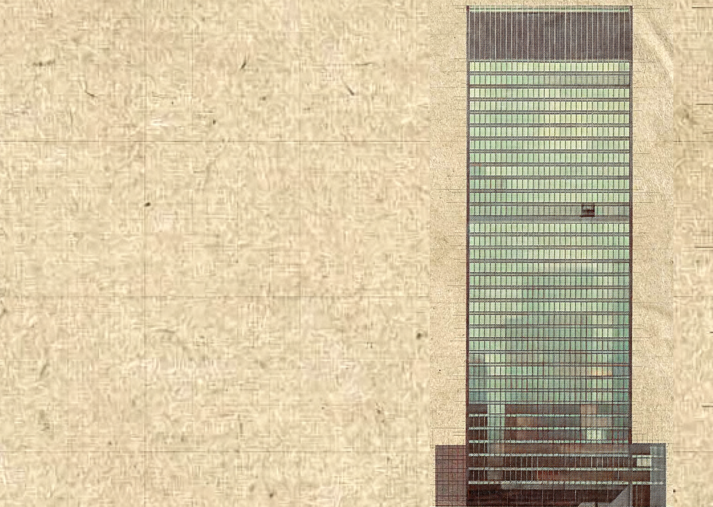

## Handoff Summary — BrandLabel Scroll-Visibility

**Date:** 2026-03-17  
**Status:** Uncommitted change in `scott-denotter-portfolio/src/components/BrandLabel.tsx`

### What Changed and Why

The fixed `BrandLabel` component (top-left "Scott Denotter" + tagline) was overlapping with body text in the `CaseStudies` section as the user scrolled. Because the BrandLabel is `fixed` at `top-6 left-12` with `z-[60]`, and the CaseStudies content starts at the same horizontal position (`pl-16`), the two pieces of text clashed visually as content scrolled beneath the label.

Two approaches were tried:
1. **Rejected** — Increase CaseStudies left padding (`md:pl-56`) to push content right of the label. Reverted per user preference.
2. **Accepted** — Make the BrandLabel hide while scrolling and reappear 500ms after scroll stops.

### Implementation

Added a scroll event listener alongside the existing `IntersectionObserver` (which is kept for section-color switching):

- `isVisible` state (boolean, default `true`) drives `opacity-0` / `opacity-100` on the root div.
- `timerRef` holds a debounce timer: scroll fires → `setIsVisible(false)` → timer set for 500ms → `setIsVisible(true)`.
- Cleanup: event listener removed and timer cleared on unmount.
- CSS: `transition-colors` widened to `transition-all` so the opacity fade is animated (500ms).

The color-switching logic (teal ↔ parchment when on Philosophy section) is unchanged and operates via the existing `IntersectionObserver`.

### Why scroll-hide over intersection-based hide

A first attempt used a `Set` inside the IntersectionObserver to track whether any section was intersecting, setting `isVisible = set.size > 0`. This failed because `rootMargin: '0px 0px -80% 0px'` only shrinks the intersection zone from the bottom — a full-height section like `Hero` (`min-h-screen`) remains "intersecting" throughout the entire scroll through it, so the Set never empties.

### Known Tradeoffs

- The label hides on **any** scroll, not just between sections. It will briefly disappear even when scrolling within the Hero. This is considered acceptable by the user (it was approved).
- The 500ms reappear delay is configurable in `BrandLabel.tsx` — adjust `setTimeout(..., 500)`.

### Files Changed

| File | Change |
|------|--------|
| `scott-denotter-portfolio/src/components/BrandLabel.tsx` | Added scroll-hide/show logic; widened CSS transition |

### No Other Files Changed

`CaseStudies.tsx` was temporarily modified (padding increase) then reverted — it is clean at its original state.

---

## Agent Notes

- **Scroll-hide tradeoff**: The label hides on any scroll event, not just cross-section transitions. A section-aware approach was attempted first (IntersectionObserver + Set) but failed due to full-height sections never leaving the intersection zone. If a future implementer wants section-precise hiding, sentinel elements (1px divs at each section boundary) observed with a narrow rootMargin window would be the right approach.
- **500ms delay**: Tunable. Lower (~300ms) feels snappier; higher (~800ms) feels more deliberate. Currently at 500ms.
- **Color classes**: `text-teal` vs `text-parchment` rely on Tailwind v4 `@theme` custom properties defined in `src/index.css`. These are not standard Tailwind colors.
- **`transition-all`**: Changed from `transition-colors` to allow opacity animation alongside color. No negative side effects expected given the element only transitions color and opacity.

This file is a merged representation of the entire codebase, combined into a single document by Repomix.
The content has been processed where empty lines have been removed, line numbers have been added.

# File Summary

## Purpose
This file contains a packed representation of the entire repository's contents.
It is designed to be easily consumable by AI systems for analysis, code review,
or other automated processes.

## File Format
The content is organized as follows:
1. This summary section
2. Repository information
3. Directory structure
4. Repository files (if enabled)
5. Multiple file entries, each consisting of:
  a. A header with the file path (## File: path/to/file)
  b. The full contents of the file in a code block

## Usage Guidelines
- This file should be treated as read-only. Any changes should be made to the
  original repository files, not this packed version.
- When processing this file, use the file path to distinguish
  between different files in the repository.
- Be aware that this file may contain sensitive information. Handle it with
  the same level of security as you would the original repository.

## Notes
- Some files may have been excluded based on .gitignore rules and Repomix's configuration
- Binary files are not included in this packed representation. Please refer to the Repository Structure section for a complete list of file paths, including binary files
- Files matching patterns in .gitignore are excluded
- Files matching default ignore patterns are excluded
- Empty lines have been removed from all files
- Line numbers have been added to the beginning of each line
- Files are sorted by Git change count (files with more changes are at the bottom)

# Directory Structure
```
scott-denotter-portfolio/
  src/
    components/
      BrandLabel.tsx
      CaseStudies.tsx
      Hero.tsx
      Philosophy.tsx
    App.tsx
```

# Files

## File: scott-denotter-portfolio/src/components/BrandLabel.tsx
```typescript
 1: import { useEffect, useRef, useState } from 'react';
 2: type Section = 'hero' | 'philosophy' | 'case-studies';
 3: export default function BrandLabel() {
 4:   const [activeSection, setActiveSection] = useState<Section>('hero');
 5:   const [isVisible, setIsVisible] = useState(true);
 6:   const timerRef = useRef<ReturnType<typeof setTimeout> | null>(null);
 7:   useEffect(() => {
 8:     const ids: Section[] = ['hero', 'philosophy', 'case-studies'];
 9:     // Track section color
10:     const colorObserver = new IntersectionObserver(
11:       (entries) => {
12:         const visible = entries
13:           .filter((e) => e.isIntersecting)
14:           .sort((a, b) => a.boundingClientRect.top - b.boundingClientRect.top);
15:         if (visible.length > 0) {
16:           setActiveSection(visible[0].target.id as Section);
17:         }
18:       },
19:       { rootMargin: '0px 0px -80% 0px', threshold: 0 }
20:     );
21:     ids.forEach((id) => {
22:       const el = document.getElementById(id);
23:       if (el) colorObserver.observe(el);
24:     });
25:     // Hide while scrolling, reappear 500ms after scroll stops
26:     const handleScroll = () => {
27:       setIsVisible(false);
28:       if (timerRef.current) clearTimeout(timerRef.current);
29:       timerRef.current = setTimeout(() => setIsVisible(true), 500);
30:     };
31:     window.addEventListener('scroll', handleScroll, { passive: true });
32:     return () => {
33:       colorObserver.disconnect();
34:       window.removeEventListener('scroll', handleScroll);
35:       if (timerRef.current) clearTimeout(timerRef.current);
36:     };
37:   }, []);
38:   const colorClass =
39:     activeSection === 'philosophy' ? 'text-parchment' : 'text-teal';
40:   return (
41:     <div className={`fixed top-6 left-6 md:left-12 z-[60] pointer-events-none select-none transition-all duration-500 ${colorClass} ${isVisible ? 'opacity-100' : 'opacity-0'}`}>
42:       <div className="text-2xl md:text-3xl font-serif font-bold tracking-tighter leading-none">
43:         Scott Denotter
44:       </div>
45:       <div className="text-xs md:text-sm font-serif italic opacity-70 mt-1 tracking-normal">
46:         I build stable, simple software.
47:       </div>
48:     </div>
49:   );
50: }
```

## File: scott-denotter-portfolio/src/App.tsx
```typescript
 1: /**
 2:  * @license
 3:  * SPDX-License-Identifier: Apache-2.0
 4:  */
 5: import Navbar from './components/Navbar';
 6: import BrandLabel from './components/BrandLabel';
 7: import Hero from './components/Hero';
 8: import Philosophy from './components/Philosophy';
 9: import CaseStudies from './components/CaseStudies';
10: import Footer from './components/Footer';
11: import { motion, useScroll, useSpring } from 'motion/react';
12: export default function App() {
13:   const { scrollYProgress } = useScroll();
14:   const scaleX = useSpring(scrollYProgress, {
15:     stiffness: 100,
16:     damping: 30,
17:     restDelta: 0.001
18:   });
19:   return (
20:     <div className="relative min-h-screen selection:bg-burgundy selection:text-parchment">
21:       {/* Fixed hero background — image stays pinned, text scrolls away */}
22:       <div className="fixed inset-0 -z-20">
23:         <picture>
24:           <source media="(max-width: 768px)" srcSet="/design/images/mobile.png" />
25:           
30:         </picture>
31:       </div>
32:       {/* Grain Overlay */}
33:       <div className="grain-overlay" />
34:       {/* Progress Bar */}
35:       <motion.div
36:         className="fixed top-0 left-0 right-0 h-1 bg-burgundy z-[60] origin-left"
37:         style={{ scaleX }}
38:       />
39:       <Navbar />
40:       <BrandLabel />
41:       <main>
42:         <Hero />
43:         <Philosophy />
44:         <CaseStudies />
45:       </main>
46:       <Footer />
47:     </div>
48:   );
49: }
```

## File: scott-denotter-portfolio/src/components/CaseStudies.tsx
```typescript
 1: import { motion } from 'motion/react';
 2: export default function CaseStudies() {
 3:   const projects = [
 4:     {
 5:       title: "The Monolith Diagnosis",
 6:       description: "Diagnosed a structural failure in a legacy system experiencing 40% downtime. Instead of indulging an expensive full-system rewrite, I stabilized the existing data layer in 3 weeks, saving the client $200k in unnecessary costs.",
 7:       tech: "Node.js · PostgreSQL · Redis",
 8:       color: "burgundy"
 9:     },
10:     {
11:       title: "Operational Clarity",
12:       description: "Replaced 14 disconnected spreadsheets for a mid-size logistics firm with a unified diagnostic dashboard and automated workflow. This streamlined operations and dropped their revenue-draining error rate from 5% to <0.1%.",
13:       tech: "Go · Kubernetes · AWS",
14:       color: "sienna"
15:     },
16:     {
17:       title: "Simplicity Audit",
18:       description: "Conducted a simplicity audit for internal teams overwhelmed by an over-engineered microservices architecture. Consolidated 12 services down to 3, cutting their operational overhead by 70%.",
19:       tech: "React · TypeScript · Prometheus",
20:       color: "teal"
21:     }
22:   ];
23:   return (
24:     <section id="case-studies" className="py-32 pl-6 md:pl-16 pr-6 md:pr-12 max-w-5xl">
25:       <motion.div
26:         initial={{ opacity: 0, y: 20 }}
27:         whileInView={{ opacity: 1, y: 0 }}
28:         viewport={{ once: true }}
29:         className="mb-24 flex flex-col md:flex-row md:items-end justify-between"
30:       >
31:         <div>
32:           <span className="text-xs uppercase tracking-[0.5em] mb-4 block opacity-60">Selected Works</span>
33:           <h2 className="text-5xl md:text-7xl font-serif">Diagnostic Reports</h2>
34:         </div>
35:         <div className="mt-8 md:mt-0 max-w-xs text-sm opacity-60 font-mono">
36:           "Most developers build what you ask for. I figure out what you actually need."
37:         </div>
38:       </motion.div>
39:       <div className="space-y-32">
40:         {projects.map((project, i) => (
41:           <motion.div
42:             key={project.title}
43:             initial={{ opacity: 0, y: 50 }}
44:             whileInView={{ opacity: 1, y: 0 }}
45:             viewport={{ once: true, margin: "-100px" }}
46:             className="grid grid-cols-1 md:grid-cols-12 gap-12 items-start group"
47:           >
48:             {/* Project Number */}
49:             <div className="hidden md:block md:col-span-1 text-xs opacity-30 pt-4">
50:               [0{i + 1}]
51:             </div>
52:             {/* Content */}
53:             <div className="md:col-span-6">
54:               <h3 className="text-4xl md:text-6xl font-serif mb-8">
55:                 {project.title}
56:               </h3>
57:               <div className="space-y-8">
58:                 <p className="text-lg leading-relaxed">{project.description}</p>
59:                 <div>
60:                   <h4 className="text-xs uppercase tracking-widest opacity-40 mb-2">Tags</h4>
61:                   <p className="text-sm font-mono opacity-60">{project.tech}</p>
62:                 </div>
63:               </div>
64:             </div>
65:             {/* Visual Placeholder */}
66:             <div className="md:col-span-5 aspect-[4/3] bg-teal/5 border border-teal/10 relative overflow-hidden">
67:               <div className={`absolute inset-0 opacity-10 bg-${project.color}`} />
68:               <div className="absolute inset-0 flex items-center justify-center">
69:                 <div className="w-3/4 h-3/4 border border-teal/20 flex flex-col p-6 justify-between">
70:                   <div className="text-[8px] uppercase tracking-widest opacity-40">{project.tech}</div>
71:                   <div className="h-px bg-teal/20 w-full" />
72:                   <div className="text-[8px] uppercase tracking-widest opacity-40 self-end">Diagnostic Report</div>
73:                 </div>
74:               </div>
75:             </div>
76:           </motion.div>
77:         ))}
78:       </div>
79:     </section>
80:   );
81: }
```

## File: scott-denotter-portfolio/src/components/Hero.tsx
```typescript
 1: import { motion } from 'motion/react';
 2: export default function Hero() {
 3:   return (
 4:     <section id="hero" className="relative min-h-screen flex flex-col md:flex-row items-center pt-24 overflow-hidden">
 5:       {/* Bio Content — centred on mobile, pushed right on desktop */}
 6:       <div className="w-full md:w-3/5 px-6 md:px-12 z-10">
 7:         <motion.div
 8:           initial={{ opacity: 0, y: 30 }}
 9:           animate={{ opacity: 1, y: 0 }}
10:           transition={{ duration: 0.8, ease: "easeOut" }}
11:         >
12:           <div className="max-w-prose rounded-2xl p-6 sm:p-8 bg-[rgba(230,225,215,0.15)] backdrop-blur-sm border border-white/30 shadow-[0_8px_30px_rgba(0,0,0,0.04)] md:bg-transparent md:backdrop-blur-none md:border-none md:shadow-none md:p-0 md:ml-12">
13:             <p className="text-base md:text-2xl leading-relaxed text-teal/90 mb-4 font-serif">
14:               I'm a back-end software developer with a foundation in applied mathematics, focused on building stable, resilient systems through data and automation. Currently working as an independent developer, I partner with businesses to solve their most complex technical bottlenecks. My day-to-day ranges from engineering automated reporting tools and data analytics platforms for e-commerce clients, to designing adversarial coding protocols that stress-test Large Language Models.
15:             </p>
16:             <p className="text-base md:text-2xl leading-relaxed text-teal/90 mb-6 font-serif">
17:               Previously, I've optimized workflows and built core features across the finance and energy sectors for companies like Bank of Montreal (BMO) and Energy Profiles Limited. These experiences—whether speeding up commercial lending cycles or detecting anomalies in utility consumption—have shaped my approach to writing clean, scalable code that directly drives business results.
18:             </p>
19:             <motion.div 
20:               className="h-px bg-teal w-24"
21:               initial={{ width: 0 }}
22:               animate={{ width: 96 }}
23:               transition={{ delay: 0.5, duration: 1 }}
24:             />
25:           </div>
26:         </motion.div>
27:       </div>
28:       {/* Abstract Architectural Overlay (keeping some of the previous vibe) */}
29:       <motion.div 
30:         className="absolute right-0 top-0 w-full md:w-1/2 h-full z-5 opacity-10 pointer-events-none"
31:         initial={{ x: 100, opacity: 0 }}
32:         animate={{ x: 0, opacity: 1 }}
33:         transition={{ duration: 1.2, ease: "easeOut", delay: 0.2 }}
34:       >
35:         <div className="relative w-full h-full flex items-center justify-center">
36:           <div className="absolute bottom-0 right-0 w-4/5 h-4/5 border-l border-t border-teal/20" />
37:           <div className="z-10 text-[15vw] font-serif text-teal/5 select-none">
38:           </div>
39:         </div>
40:       </motion.div>
41:       {/* Scroll Indicator */}
42:       <motion.div 
43:         className="absolute bottom-12 left-6 md:left-12 flex items-center space-x-4 z-10"
44:         initial={{ opacity: 0 }}
45:         animate={{ opacity: 1 }}
46:         transition={{ delay: 1.5 }}
47:       >
48:         <div className="text-[10px] uppercase tracking-[0.3em] rotate-90 origin-left translate-x-4">Scroll</div>
49:         <div className="w-px h-12 bg-teal/30" />
50:       </motion.div>
51:     </section>
52:   );
53: }
```

## File: scott-denotter-portfolio/src/components/Philosophy.tsx
```typescript
 1: import { motion, useScroll, useTransform } from 'motion/react';
 2: import { useRef } from 'react';
 3: export default function Philosophy() {
 4:   const containerRef = useRef(null);
 5:   const { scrollYProgress } = useScroll({
 6:     target: containerRef,
 7:     offset: ["start end", "end start"]
 8:   });
 9:   const yTranslate = useTransform(scrollYProgress, [0, 1], [40, -40]);
10:   const principles = [
11:     {
12:       title: "Diagnosis First",
13:       description: "I need to understand before I build. My first question is never \"what do you want built?\" It's \"what's actually going wrong?\" To me, the diagnostic process is the core product, not just a free add-on."
14:     },
15:     {
16:       title: "Simplicity as Craft",
17:       description: "The simplest working solution is always the best solution. It takes more skill to resist over-engineering than to indulge it, so I frequently work with clients to cut away complexity they don't actually need."
18:     },
19:     {
20:       title: "Outcome First",
21:       description: "You aren't buying code; you're buying results. I frame every project around what actually changes for your business—whether that's time saved, costly errors eliminated, or decisions made faster."
22:     },
23:     {
24:       title: "Honest Expertise",
25:       description: "I strive to be the expert who tells the truth. Credibility comes from candour, not just credentials. I understand the craft deeply enough to teach it, and I bring that transparency into every client partnership."
26:     }
27:   ];
28:   return (
29:     <section
30:       ref={containerRef}
31:       id="philosophy"
32:       className="py-24 px-6 md:px-12 relative overflow-hidden bg-teal shadow-[0_-20px_50px_rgba(0,0,0,0.4)] z-10 border-t border-umber/20"
33:     >
34:       {/* Dot grid overlay */}
35:       <div
36:         className="absolute inset-0 pointer-events-none"
37:         style={{
38:           backgroundImage: `radial-gradient(circle at 2px 2px, rgba(175, 219, 188, 0.06) 1px, transparent 0)`,
39:           backgroundSize: '40px 40px'
40:         }}
41:       />
42:       {/* Twin gold buildings accent — left side bleed */}
43:       <div className="absolute top-0 left-0 w-[55%] h-full pointer-events-none select-none overflow-hidden hidden md:block">
44:         <motion.img
45:           style={{ y: yTranslate }}
46:           src="/design/images/twin_gold_buildings.jpg"
47:           alt=""
48:           className="absolute top-0 left-0 w-full h-[120%] object-cover object-center opacity-[0.12] mix-blend-soft-light"
49:         />
50:       </div>
51:       {/* Top fade — blends from hero parchment into teal */}
52:       {/* Bottom vignette */}
53:       <div className="absolute bottom-0 left-0 right-0 h-24 bg-gradient-to-t from-[#2a8fa5]/60 to-transparent pointer-events-none" />
54:       <div className="max-w-7xl mx-auto relative z-10">
55:         <div className="mb-16">
56:           <span className="text-xs uppercase tracking-[0.5em] mb-4 block opacity-50 font-mono text-mint">Brand Pillars</span>
57:           <h2 className="text-5xl md:text-8xl font-serif max-w-4xl leading-[1.1] text-parchment">
58:             The non-negotiable <br className="hidden md:block" />
59:             <span className="italic">truths</span> of my craft.
60:           </h2>
61:         </div>
62:         {/* Decorative divider */}
63:         <div className="w-full h-px bg-gradient-to-r from-mint/30 via-mint/10 to-transparent mb-10" />
64:         <div className="grid grid-cols-1 md:grid-cols-2 gap-6">
65:           {principles.map((p, i) => (
66:             <div
67:               key={p.title}
68:               className="group rounded-lg p-8 border border-white/[0.08] bg-white/[0.03] hover:bg-white/[0.06] backdrop-blur-sm transition-all duration-500"
69:             >
70:               <div className="text-burgundy font-serif text-6xl mb-8 opacity-40 group-hover:opacity-100 group-hover:text-mint transition-all duration-500">
71:                 0{i + 1}
72:               </div>
73:               <h3 className="text-2xl font-serif mb-6 text-parchment group-hover:text-mint transition-colors duration-300">
74:                 {p.title}
75:               </h3>
76:               <p className="text-sm leading-relaxed text-sage font-mono group-hover:text-parchment transition-colors">
77:                 {p.description}
78:               </p>
79:               <div className="w-12 h-[1px] bg-mint mt-8 origin-left scale-x-50 group-hover:scale-x-100 transition-transform duration-500" />
80:             </div>
81:           ))}
82:         </div>
83:       </div>
84:     </section>
85:   );
86: }
```
