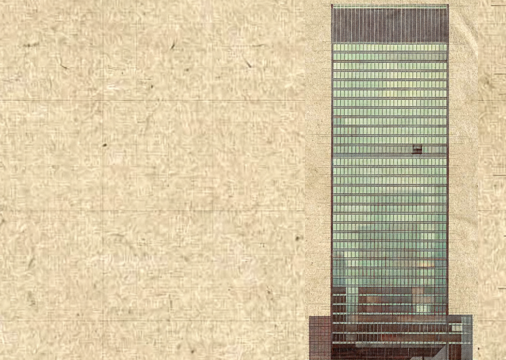

This file is a merged representation of the entire codebase, combined into a single document by Repomix.
The content has been processed where empty lines have been removed, line numbers have been added.

# File Summary

## Purpose
This file contains a packed representation of the entire repository's contents.
It is designed to be easily consumable by AI systems for analysis, code review,
or other automated processes.

## File Format
The content is organized as follows:
1. This summary section
2. Repository information
3. Directory structure
4. Repository files (if enabled)
5. Multiple file entries, each consisting of:
  a. A header with the file path (## File: path/to/file)
  b. The full contents of the file in a code block

## Usage Guidelines
- This file should be treated as read-only. Any changes should be made to the
  original repository files, not this packed version.
- When processing this file, use the file path to distinguish
  between different files in the repository.
- Be aware that this file may contain sensitive information. Handle it with
  the same level of security as you would the original repository.

## Notes
- Some files may have been excluded based on .gitignore rules and Repomix's configuration
- Binary files are not included in this packed representation. Please refer to the Repository Structure section for a complete list of file paths, including binary files
- Files matching patterns in .gitignore are excluded
- Files matching default ignore patterns are excluded
- Empty lines have been removed from all files
- Line numbers have been added to the beginning of each line
- Files are sorted by Git change count (files with more changes are at the bottom)

# Directory Structure
```
scott-denotter-portfolio/
  src/
    components/
      Hero.tsx
      Philosophy.tsx
    index.css
```

# Files

## File: scott-denotter-portfolio/src/components/Hero.tsx
```typescript
 1: import { motion } from 'motion/react';
 2: export default function Hero() {
 3:   return (
 4:     <section className="relative min-h-screen flex flex-col md:flex-row items-center pt-24 overflow-hidden">
 5:       {/* Background Images */}
 6:       <div className="absolute inset-0 z-0">
 7:         <picture>
 8:           <source media="(max-width: 768px)" srcSet="/design/images/mobile.png" />
 9:           
15:         </picture>
16:       </div>
17:       {/* Left Content */}
18:       <div className="w-full md:w-3/5 px-6 md:px-12 z-10">
19:         <motion.div
20:           initial={{ opacity: 0, y: 30 }}
21:           animate={{ opacity: 1, y: 0 }}
22:           transition={{ duration: 0.8, ease: "easeOut" }}
23:         >
24:           <h1 className="text-5xl md:text-7xl lg:text-8xl font-serif leading-[0.9] tracking-tighter text-teal mb-8">
25:             Less system.<br />
26:             More solution.
27:           </h1>
28:           <div className="max-w-xl">
29:             <p className="text-xl md:text-2xl leading-relaxed text-teal/90 mb-6 font-serif italic">
30:               "You don't need a developer who builds what you ask for. You need one who figures out what you actually need — then builds the simplest thing that solves it."
31:             </p>
32:             <p className="text-sm md:text-base leading-relaxed opacity-70 mb-8 font-mono uppercase tracking-widest">
33:               Scott Denotter — Diagnosis before prescription.
34:             </p>
35:             <motion.div 
36:               className="h-px bg-teal w-24"
37:               initial={{ width: 0 }}
38:               animate={{ width: 96 }}
39:               transition={{ delay: 0.5, duration: 1 }}
40:             />
41:           </div>
42:         </motion.div>
43:       </div>
44:       {/* Abstract Architectural Overlay (keeping some of the previous vibe) */}
45:       <motion.div 
46:         className="absolute right-0 top-0 w-full md:w-1/2 h-full z-5 opacity-10 pointer-events-none"
47:         initial={{ x: 100, opacity: 0 }}
48:         animate={{ x: 0, opacity: 1 }}
49:         transition={{ duration: 1.2, ease: "easeOut", delay: 0.2 }}
50:       >
51:         <div className="relative w-full h-full flex items-center justify-center">
52:           <div className="absolute bottom-0 right-0 w-4/5 h-4/5 border-l border-t border-teal/20" />
53:           <div className="z-10 text-[15vw] font-serif text-teal/5 select-none">
54:           </div>
55:         </div>
56:       </motion.div>
57:       {/* Scroll Indicator */}
58:       <motion.div 
59:         className="absolute bottom-12 left-6 md:left-12 flex items-center space-x-4 z-10"
60:         initial={{ opacity: 0 }}
61:         animate={{ opacity: 1 }}
62:         transition={{ delay: 1.5 }}
63:       >
64:         <div className="text-[10px] uppercase tracking-[0.3em] rotate-90 origin-left translate-x-4">Scroll</div>
65:         <div className="w-px h-12 bg-teal/30" />
66:       </motion.div>
67:     </section>
68:   );
69: }
```

## File: scott-denotter-portfolio/src/index.css
```css
 1: @import "tailwindcss";
 2: @theme {
 3:   /* Updated to match your architectural palette exactly */
 4:   --color-parchment: #E8DFC8;
 5:   --color-mint: #afdbbc;    /* The light highlight color */
 6:   --color-teal: #103c35;    /* The deep, dark teal from the palette */
 7:   --color-burgundy: #300100; /* The rich, dark red-black */
 8:   --color-sienna: #81542f;   /* The warm copper/brown */
 9:   --color-olive: #c0bd8c;    /* Muted yellow-green */
10:   --color-sage: #979a7f;     /* Muted stone/grey-green */
11:   --color-umber: #452a17;    /* Dark espresso brown */
12:   --font-serif: "Playfair Display", serif;
13:   --font-mono: "IBM Plex Mono", monospace;
14: }
15: @layer base {
16:   body {
17:     /* Using 'umber' for body text instead of 'teal' makes the parchment feel more like old paper */
18:     @apply bg-parchment text-umber font-mono antialiased;
19:     background-image: url("data:image/svg+xml,%3Csvg viewBox='0 0 200 200' xmlns='http://www.w3.org/2000/svg'%3E%3Cfilter id='noiseFilter'%3E%3CfeTurbulence type='fractalNoise' baseFrequency='0.65' numOctaves='3' stitchTiles='stitch'/%3E%3C/filter%3E%3Crect width='100%25' height='100%25' filter='url(%23noiseFilter)'/%3E%3C/svg%3E");
20:     background-repeat: repeat;
21:     background-size: 200px 200px;
22:   }
23:   h1, h2, h3, h4, h5, h6 {
24:     @apply font-serif text-teal; /* Headers keep the teal brand color */
25:   }
26: }
27: /* ... keep your .grain-overlay as is ... */
```

## File: scott-denotter-portfolio/src/components/Philosophy.tsx
```typescript
 1: import { motion, useScroll, useTransform } from 'motion/react';
 2: import { useRef } from 'react';
 3: export default function Philosophy() {
 4:   const containerRef = useRef(null);
 5:   const { scrollYProgress } = useScroll({
 6:     target: containerRef,
 7:     offset: ["start end", "end start"]
 8:   });
 9:   const yTranslate = useTransform(scrollYProgress, [0, 1], [40, -40]);
10:   const principles = [
11:     {
12:       title: "Diagnosis First",
13:       description: "Understand before you build. Scott's first question is never 'what do you want built?' It's 'what's actually going wrong?' The diagnostic process is the product, not a free add-on."
14:     },
15:     {
16:       title: "Simplicity as Craft",
17:       description: "The simplest working solution is the best solution. It takes more skill to resist over-engineering than to indulge it. Scott regularly talks clients down from complexity they don't need."
18:     },
19:     {
20:       title: "Outcome First",
21:       description: "Clients don't buy code. They buy results. Every project is framed around what changed for the business — time saved, errors eliminated, decisions made faster."
22:     },
23:     {
24:       title: "Honest Expertise",
25:       description: "Be the expert who tells the truth. Credibility comes from candour, not credentials. Scott understands the craft deeply enough to teach it, which provides proof of expertise."
26:     }
27:   ];
28:   return (
29:     <section
30:       ref={containerRef}
31:       id="philosophy"
32:       className="py-24 px-6 md:px-12 relative overflow-hidden"
33:       style={{
34:         background: `radial-gradient(ellipse at 30% 50%, #4dbfd4 0%, #3aacbf 50%, #2a8fa5 100%)`,
35:       }}
36:     >
37:       {/* Dot grid overlay */}
38:       <div
39:         className="absolute inset-0 pointer-events-none"
40:         style={{
41:           backgroundImage: `radial-gradient(circle at 2px 2px, rgba(175, 219, 188, 0.06) 1px, transparent 0)`,
42:           backgroundSize: '40px 40px'
43:         }}
44:       />
45:       {/* Twin gold buildings accent — left side bleed */}
46:       <div className="absolute top-0 left-0 w-[55%] h-full pointer-events-none select-none overflow-hidden hidden md:block">
47:         <motion.img
48:           style={{ y: yTranslate }}
49:           src="/design/images/twin_gold_buildings.jpg"
50:           alt=""
51:           className="absolute top-0 left-0 w-full h-[120%] object-cover object-center opacity-[0.12] mix-blend-soft-light"
52:         />
53:         {/* Fade-out gradient on the right edge of the image */}
54:         <div className="absolute inset-0 bg-gradient-to-l from-[#3aacbf] via-[#3aacbf]/80 to-transparent" />
55:       </div>
56:       {/* Top fade — blends from hero parchment into teal */}
57:       <div className="absolute top-0 left-0 right-0 h-40 bg-gradient-to-b from-[#E8DFC8] via-[#E8DFC8]/30 to-transparent pointer-events-none z-20" />
58:       {/* Bottom vignette */}
59:       <div className="absolute bottom-0 left-0 right-0 h-24 bg-gradient-to-t from-[#2a8fa5]/60 to-transparent pointer-events-none" />
60:       <div className="max-w-7xl mx-auto relative z-10">
61:         <div className="mb-16">
62:           <span className="text-xs uppercase tracking-[0.5em] mb-4 block opacity-50 font-mono text-mint">Brand Pillars</span>
63:           <h2 className="text-5xl md:text-8xl font-serif max-w-4xl leading-[1.1] text-parchment">
64:             The non-negotiable <br className="hidden md:block" />
65:             <span className="italic">truths</span> of the craft.
66:           </h2>
67:         </div>
68:         {/* Decorative divider */}
69:         <div className="w-full h-px bg-gradient-to-r from-mint/30 via-mint/10 to-transparent mb-10" />
70:         <div className="grid grid-cols-1 md:grid-cols-2 gap-6">
71:           {principles.map((p, i) => (
72:             <div
73:               key={p.title}
74:               className="group rounded-lg p-8 border border-white/[0.08] bg-white/[0.03] hover:bg-white/[0.06] backdrop-blur-sm transition-all duration-500"
75:             >
76:               <div className="text-burgundy font-serif text-6xl mb-8 opacity-40 group-hover:opacity-100 group-hover:text-mint transition-all duration-500">
77:                 0{i + 1}
78:               </div>
79:               <h3 className="text-2xl font-serif mb-6 text-parchment group-hover:text-mint transition-colors duration-300">
80:                 {p.title}
81:               </h3>
82:               <p className="text-sm leading-relaxed text-sage font-mono group-hover:text-parchment transition-colors">
83:                 {p.description}
84:               </p>
85:               <div className="w-12 h-[1px] bg-mint mt-8 origin-left scale-x-50 group-hover:scale-x-100 transition-transform duration-500" />
86:             </div>
87:           ))}
88:         </div>
89:       </div>
90:     </section>
91:   );
92: }
```
